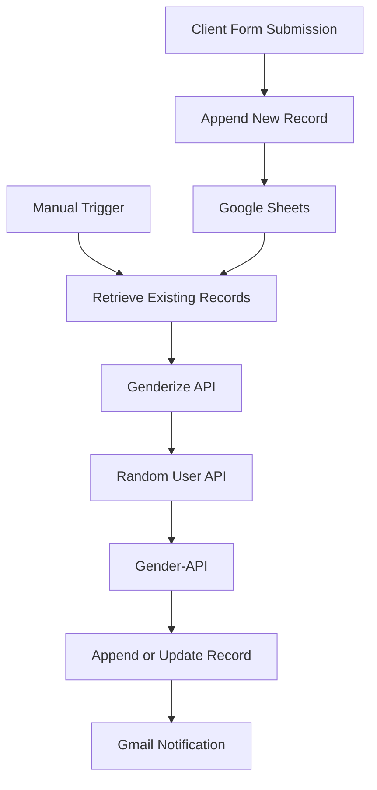

# ⚡ Client Onboarding & Data Enrichment Automation

**Automating client data collection, Google Sheets management, API integration, and Gmail notifications using n8n.**

[](https://n8n.io/)
[](https://workspace.google.com/products/sheets/)
[](https://mail.google.com/)
[](https://developer.mozilla.org/en-US/docs/Web/HTTP)

## 📌 Overview

This project is an **n8n-based workflow automation system** designed to simplify client onboarding and data processing.

It collects information through a web form, stores records in Google Sheets, retrieves existing spreadsheet data, integrates external APIs for additional profile information, updates spreadsheet records, and sends email notifications through Gmail.

By connecting multiple services into a single workflow, the project demonstrates how repetitive administrative tasks can be automated with minimal manual intervention.

## ✨ Key Features

- **Automated Data Collection:** Captures client details through an n8n form.
- **Google Sheets Integration:** Appends new submissions and updates records using an identifier.
- **REST API Integration:** Connects to external APIs through HTTP Request nodes.
- **Data Enrichment:** Retrieves gender estimates and sample profile information from external services.
- **Automated Email Notifications:** Sends client details to a configured Gmail recipient.
- **Manual Workflow Execution:** Supports a separate manual trigger for processing spreadsheet records.
- **Visual Workflow Design:** Uses connected n8n nodes to orchestrate the entire process.

## 🏗️ Workflow Architecture



The workflow has two entry points:

1. **Form-triggered flow:** Receives new client information and appends it to Google Sheets.
2. **Manual processing flow:** Retrieves spreadsheet records, calls the configured APIs, updates records, and sends an email notification.

## 🔄 How It Works

### Step 1 — Collect Client Information

The n8n form accepts the following fields:

| Field | Purpose |
|---|---|
| `id` | Record identifier |
| `name` | Client name |
| `number` | Contact number |
| `budget` | Client budget |
| `gender` | Gender field |
| `nationality` | Nationality field |

### Step 2 — Store Data in Google Sheets

The form submission is appended to a Google Sheets document. This provides a centralized location for storing and managing submitted records.

### Step 3 — Retrieve and Process Records

The workflow can also be started manually. It retrieves spreadsheet records and passes the data through HTTP Request nodes that call external APIs.

### Step 4 — Enrich the Data

The workflow uses:

- **Genderize API:** Estimates gender from a name.
- **Random User API:** Returns sample profile information, including gender and country.
- **Gender-API:** Performs an additional gender lookup.

The returned values are mapped to spreadsheet fields. API results should be validated before being treated as accurate information about a real client.

### Step 5 — Update Google Sheets

The workflow uses an append-or-update operation with the `id` field as its matching key, allowing it to update the corresponding record rather than always creating another row.

### Step 6 — Send an Email Notification

After the spreadsheet update, the Gmail node sends an email containing the configured client details to the specified recipient.

## 🧰 Technology Stack

| Technology | Role |
|---|---|
| n8n | Workflow automation and orchestration |
| Google Sheets API integration | Record storage and updates |
| Gmail integration | Email notifications |
| Genderize API | Name-based gender estimation |
| Random User API | Sample profile data |
| Gender-API | Additional gender lookup |
| HTTP / REST APIs | Communication between services |
| JSON | Workflow configuration and data exchange |

## 🚀 Getting Started

### Prerequisites

Before importing the workflow, ensure you have:

- An n8n account or self-hosted n8n instance
- A Google account with access to Google Sheets
- Gmail access for sending notifications
- Internet connectivity for external API requests

### 1. Clone the Repository

```bash
git clone https://github.com/YOUR_USERNAME/YOUR_REPOSITORY.git
cd YOUR_REPOSITORY
```

Replace the placeholder URL with your repository's actual URL.

### 2. Import the Workflow

1. Open n8n.
2. Create a workflow or open the workflow management page.
3. Select **Import from File**.
4. Choose `workflow.json` from the cloned repository.
5. Review the imported nodes and connections.

### 3. Configure Google Sheets

1. Open the Google Sheets nodes.
2. Create or select your Google Sheets OAuth2 credentials.
3. Select your own spreadsheet and worksheet.
4. Configure the spreadsheet ID and column mappings.
5. Ensure the `id`, `name`, `number`, `budget`, `gender`, and `nationality` columns match the workflow.

### 4. Configure Gmail

1. Open the Gmail node.
2. Connect your own Gmail OAuth2 credentials.
3. Replace `YOUR_EMAIL_ADDRESS@example.com` with your intended recipient.
4. Review the email subject and message template.

### 5. Verify API Requests

Inspect each HTTP Request node to verify:

- The endpoint URL
- Query parameter expressions
- Expected response structure
- API authentication requirements
- Rate limits and error handling

Some providers may require API keys or a paid plan.

### 6. Test the Workflow

Use test data and a test spreadsheet first.

- Submit a sample record through the form.
- Verify that the record is appended to Google Sheets.
- Execute the manual-processing path separately.
- Inspect the HTTP Request node outputs.
- Confirm that the correct record is updated.
- Verify that the Gmail notification is delivered.

**Note:** The form-triggered and manual-processing paths are separate entry points. Test both independently before using the workflow with real data.

## 🔐 Security and Privacy

Security is essential when publishing automation projects on GitHub.

- Never commit OAuth tokens, API keys, passwords, or client secrets.
- Use n8n's credential manager for authentication.
- Replace private spreadsheet IDs, URLs, and personal email addresses in public workflow exports.
- Do not publish real customer names, phone numbers, budgets, or other sensitive data.
- Use your own credentials when importing the workflow.
- Review previous Git commits if sensitive information was committed accidentally.
- Revoke or rotate any exposed secrets; removing them from the latest file alone is not sufficient.

This repository should contain a sanitized workflow export, not a copy of your private account configuration.

## ⚠️ Important Limitations

- Gender estimates based on names may be inaccurate.
- The Random User API provides sample profile data, not verified nationality information for the person submitting the form.
- External APIs may fail, change response formats, or impose rate limits.
- Incorrect field mappings can cause data to be written to the wrong spreadsheet column.
- The current workflow should be tested for missing fields, API failures, duplicate records, and incorrect record matching before production use.

## 💡 Potential Improvements

Possible next steps for making this workflow more production-ready:

- Add form validation and required-field checks.
- Implement API retries and error-handling branches.
- Add duplicate detection and stronger record validation.
- Use an appropriate nationality data source instead of sample profile data.
- Add logging and failure notifications.
- Improve API response validation before updating records.
- Add screenshots of the n8n workflow and sample spreadsheet with dummy data.
- Add a short demonstration video.

## 🎓 What This Project Demonstrates

This project provides practical experience with:

- No-code/low-code workflow automation
- REST API integration
- JSON data processing
- Google Sheets data management
- Gmail notification automation
- Data mapping and enrichment
- OAuth-based integrations
- Debugging multi-step workflows

## 👨‍💻 Author

**Ayush Gupta**

B.Tech — Computer Science and Engineering (AI & ML)

GitHub: [@Ayushh890](https://github.com/Ayushh890)

---

If you find this project useful, feel free to explore the workflow and adapt it to your own automation needs.

**Built with n8n to make repetitive data-processing tasks simpler and more efficient.**
